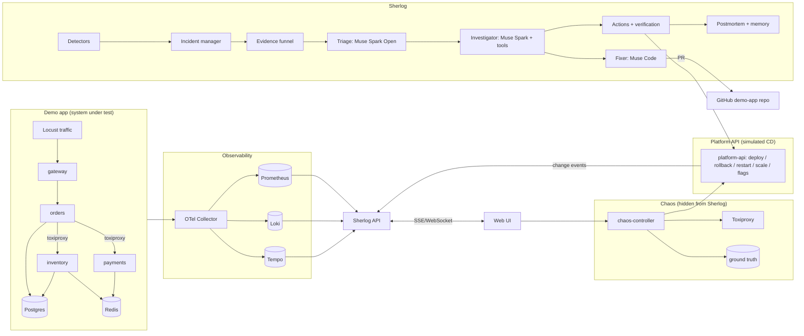

# PLAN.md — Sherlog

> **Sherlog**: un ingeniero de guardia autónomo que detecta incidentes en producción, encuentra la causa raíz real con evidencia, ejecuta acciones seguras y verifica que el sistema se recuperó.
> Proyecto para el **Meta Global AI Developer Hackathon** (Cerebral Valley). Track: **Indie Developer**. Problem statement: **Push the Frontier** (software).

---

## 0. Instrucciones para Claude Code

Lee este archivo completo antes de escribir código. Reglas de trabajo:

1. **Trabaja por fases** (sección 7). No empieces una fase sin cumplir los *criterios de aceptación* de la anterior. Al terminar cada fase, muestra cómo verificarla y actualiza la casilla `[x]` en este archivo.
2. **Idioma:** código, comentarios, commits, README y UI en **inglés** (el jurado es global). Este plan está en español.
3. **Modelos de Meta:** no inventes endpoints, nombres de modelos ni parámetros. Todo lo marcado como `TODO(VERIFY)` se confirma en la documentación oficial que te pase Miguel. Si falta información, pregunta antes de asumir.
4. **Toda la IA del producto usa modelos de Meta.** No uses modelos de otros proveedores dentro de Sherlog.
5. **Secretos:** nunca en el repo. Usa `.env` (ignorado por git) y mantén `.env.example` actualizado.
6. **El repo es público** y todo debe estar construido durante el hackathon (27 oct – 4 nov 2026). Commits pequeños y frecuentes con mensajes claros: el historial es evidencia.
7. **Sherlog nunca debe "hacer trampa":** no puede leer datos del controlador de caos ni del benchmark (ver 5.2). Solo ve lo que vería un SRE real: telemetría, eventos de cambio legítimos y código.
8. Prioriza que algo funcione de punta a punta antes de pulirlo. Si una fase se atrasa, aplica la sección 8 (recortes).

---

## 1. Contexto del hackathon (resumen)

- **Construcción:** 27 oct – 4 nov 2026. **Entrega:** miércoles 4 nov, 9:00 PM ET (= 9:00 PM Ecuador). Meta interna: entregar antes del mediodía.
- **Entrega:** repo público + video demo de **3 minutos** + producto en vivo.
- **Rúbrica:** Impacto 30% · Uso de herramientas de Meta 25% ("ir más allá de una integración básica") · Profundidad técnica 20% · Demo 25%.
- **Premios extra a los que apuntamos:** Best Agentic Use-Case ($5K), Best Build on Meta Open Weight Models ($10K, requiere Muse Spark Open o Muse Glimmer en infraestructura propia o de partners), Most Viral en X ($20K).
- **Anti-proyectos a evitar:** RAG básico, analizadores simples de imágenes. Sherlog no es ninguno de estos.

---

## 2. Modelos de Meta y su rol

| Modelo | Dónde corre | Rol en Sherlog |
|---|---|---|
| **Muse Spark** | Meta Model API | Agente investigador principal: razonamiento + tool calling + salida JSON estructurada |
| **Muse Spark Open** | Modal o Baseten (`meta-models/muse-spark-open-1026` en Baseten) | Triaje de alto volumen: resume plantillas de logs y excepciones anómalas. Argumento: "los logs sensibles se procesan en tu propia infraestructura" |
| **Muse Code** | `TODO(VERIFY)` (ver "Muse code recipes" en la doc) | Genera el parche + test para bugs de código y abre un PR |
| **Muse Voice Transcribe** | Meta Model API | El ingeniero habla con Sherlog por voz (preguntas y aprobaciones) |

`TODO(VERIFY)` antes de la Fase 3:
- Base URL de la Meta Model API, formato de autenticación y si es compatible con el SDK de OpenAI.
- IDs exactos de cada modelo.
- Soporte de tool calling y JSON schema en Muse Spark.
- Cómo se invoca Muse Code (API, CLI o SDK).
- Endpoint y formato de audio de Muse Voice Transcribe.

**Diseño obligatorio:** un único módulo `agent/sherlog/llm/` con un cliente por modelo detrás de una interfaz común, configurado por variables de entorno. Si la doc cambia, solo se toca ese módulo. Cada llamada registra modelo, tokens de entrada y salida, latencia y costo estimado.

---

## 3. Arquitectura



**Puertos sugeridos:** gateway 8000, orders 8001, payments 8002, inventory 8003, platform-api 8050, chaos-controller 8100, sherlog-api 8200, web 5173, Prometheus 9090, Loki 3100, Tempo 3200, Toxiproxy 8474, Grafana 3000 (opcional).

---

## 4. Estructura del repo

```
sherlog/
├── PLAN.md
├── README.md
├── docker-compose.yml              # todo el stack
├── .env.example
├── demo-app/                       # sistema bajo prueba
│   ├── gateway/  orders/  payments/  inventory/
│   ├── common/                     # telemetría OTel compartida
│   ├── db/                         # migraciones y seed
│   └── loadgen/                    # Locust
├── platform-api/                   # deploy / rollback / restart / scale / flags + eventos
├── chaos/                          # chaos-controller + definiciones de fallas
├── observability/                  # configs de Collector, Prometheus, Loki, Tempo
├── agent/                          # Sherlog (Python)
│   └── sherlog/
│       ├── api/                    # FastAPI + SSE
│       ├── ingest/                 # clientes Prometheus, Loki, Tempo, Docker
│       ├── detectors/
│       ├── incidents/
│       ├── topology/
│       ├── funnel/                 # compresión de evidencia
│       ├── llm/                    # clientes de modelos Meta
│       ├── investigator/
│       ├── actions/
│       ├── fixer/                  # Muse Code
│       ├── memory/
│       ├── postmortem/
│       └── voice/
├── web/                            # React + Vite + TS
├── benchmark/
│   ├── scenarios/                  # YAML
│   ├── runner/
│   └── results/
└── docs/                           # diagramas, guion de demo
```

---

## 5. Componentes en detalle

### 5.1 Demo app (sistema bajo prueba)

Una tienda online mínima con dependencias en cadena. Stack: Python 3.12+, FastAPI, SQLAlchemy, httpx, Postgres, Redis.

**Servicios y endpoints:**
- `gateway`: `GET /products`, `POST /checkout {user_id, items:[{sku, qty}]}`, `GET /orders/{id}`.
- `orders`: `POST /orders` → llama a `inventory /reserve` y luego a `payments /charge`, y persiste el pedido. Timeouts y reintentos configurables por variables de entorno.
- `inventory`: `GET /products`, `POST /reserve` sobre Postgres, con caché en Redis.
- `payments`: `POST /charge`, que simula un proveedor externo con latencia de 50–150 ms y claves de idempotencia en Redis.
- Todos exponen `GET /health`.

**Telemetría (obligatoria en todos):**
- OpenTelemetry para trazas (propagación W3C entre servicios), métricas RED (requests, errors, duration por endpoint) y logs JSON con `trace_id`, `span_id`, `service`, `version` y `level`.
- Los stack traces de excepciones van completos en el log.

**Versionado y deploys:**
- Cada servicio se construye como imagen `sherlog-demo/<service>:<git-ref>`.
- Los deploys se hacen **solo** vía `platform-api`. Cada uno registra un evento `{service, from_version, to_version, commit_sha, changed_files, timestamp, actor}` y lo envía a Sherlog (`POST /events`), como haría un sistema de CI/CD.

**Bugs reales en ramas de git** (la causa vive en el código, no en hooks artificiales):

| Rama | Servicio | Bug |
|---|---|---|
| `bug/orders-keyerror` | orders | Accede a `item["price"]` cuando el campo se llama `unit_price` |
| `bug/payments-none` | payments | No valida un `None` en la respuesta del proveedor simulado |
| `bug/inventory-memleak` | inventory | Caché en memoria sin límite que crece por request |
| `bug/orders-cpu` | orders | Algoritmo O(n²) innecesario en cada checkout |
| `bug/inventory-drop-index` | inventory | Migración que elimina el índice de `sku` y vuelve lenta la consulta |
| `noise/inventory-deprecation` | inventory | Loguea warnings ruidosos a nivel ERROR sin impacto funcional (pista falsa) |

**Generador de tráfico:** Locust con un perfil constante de 5–20 usuarios que navegan y compran, siempre encendido.

**Criterio de aceptación:** `docker compose up` levanta la tienda, Locust genera tráfico y en Tempo se ve una traza completa gateway → orders → inventory/payments.

### 5.2 platform-api y chaos-controller

**platform-api** representa la plataforma de despliegue de una empresa. Lo usan tanto Sherlog (para mitigar) como el controlador de caos (para provocar fallas).
- `POST /deploy {service, ref}`, `POST /rollback {service}` (a la versión anterior), `POST /restart {service}`, `POST /scale {service, replicas}`, `PUT /flags/{name}`, `PUT /config/{service}` (variables de entorno, con redeploy).
- Emite eventos de cambio a Sherlog **solo** para deploys, cambios de configuración y flags, porque esos los vería un SRE real.
- Usa el socket de Docker. Tiene una lista blanca de servicios: solo puede tocar los de `demo-app`.

**chaos-controller** inyecta fallas y guarda la verdad del escenario.
- `POST /faults {type, target, params}`, `DELETE /faults/{id}`, `POST /reset` (vuelve todo a la línea base) y `GET /faults/types`.
- Mecanismos: `docker kill` (caída), `docker pause` (cuelgue silencioso), Toxiproxy (latencia y cortes entre servicios), deploys de ramas con bugs vía platform-api, cambios de configuración vía platform-api (por ejemplo `RETRIES=10` sin backoff o pool de base de datos de 2 conexiones) y parada de Redis.
- La verdad de cada inyección se guarda en su propio almacenamiento. **Sherlog no tiene acceso de red a chaos-controller.** Solo la UI y el benchmark hablan con él.

**Criterio de aceptación:** cada tipo de falla se puede lanzar con un `curl`, se ve en la telemetría (métricas, logs o trazas) y `POST /reset` restaura el sistema.

### 5.3 Observabilidad

- OTel Collector recibe OTLP de los servicios y envía métricas a Prometheus (remote write o exporter), logs a Loki y trazas a Tempo.
- Retención corta (unas 24 h) y límites de memoria en compose.
- Grafana es opcional, solo para depurar.

**Criterio de aceptación:** en Prometheus hay métricas RED por servicio, en Loki se filtran logs por `service` y `trace_id`, y en Tempo se buscan trazas con error.

### 5.4 Sherlog (el agente)

Python, FastAPI, asyncio. Base de datos propia en Postgres (schema `sherlog`).

#### 5.4.1 Ingesta
Clientes para la API HTTP de Prometheus, Loki (`query_range` y `tail` por WebSocket), Tempo (búsqueda y traza por ID) y eventos de Docker (reinicios, OOMKilled, exit codes). Además, el endpoint `POST /events` recibe los eventos de cambio.

#### 5.4.2 Detectores (sin LLM)
Todos producen `Signal {type, service, severity, started_at, details}`.
- **Anomalías de métricas:** tasa de errores, latencia p95 y tráfico por servicio. Línea base con EWMA y z-score sobre una ventana de aprendizaje (10–15 min de tráfico normal al arrancar), con umbral de persistencia (por ejemplo 3 intervalos seguidos) para evitar ruido.
- **Silencio:** un servicio que dejaba N líneas de log por minuto y baja a casi 0, o un health check que falla.
- **Contenedores:** reinicios, OOMKilled y exit codes distintos de 0.
- **Drain3 en streaming** sobre todos los logs de Loki: aparición de plantillas nuevas de nivel WARN/ERROR o cambios fuertes de frecuencia frente a la línea base.
- **Huellas de excepciones:** parseo de stack traces y huella = hash(tipo de excepción + los 3–5 primeros frames del código propio, ignorando frames de librerías). Alerta ante una huella nueva o un pico de una conocida.

#### 5.4.3 Gestor de incidentes
- Agrupa las señales en un incidente si ocurren en una ventana corta (unos 2 min) y en servicios conectados en el mapa de dependencias.
- Estados: `detected → investigating → mitigating → verifying → resolved | escalated`.
- Cada transición se publica por SSE a la UI.

#### 5.4.4 Topología
Construye el grafo de dependencias servicio → servicio a partir de las trazas de Tempo y lo refresca periódicamente. Lo usan el gestor de incidentes, la heurística de causa raíz y la UI.

#### 5.4.5 Embudo de evidencia (clave para costos)
El LLM **nunca** recibe logs crudos. El embudo:
1. Ventana temporal del incidente (desde un poco antes del primer cambio brusco).
2. Servicios sospechosos: los afectados y sus dependencias aguas abajo según el grafo.
3. Logs de las trazas con error o lentas, filtrados por `trace_id`.
4. Plantillas de Drain que son nuevas o se dispararon frente a la línea base, con conteos y 2–3 ejemplos cada una.
5. Huellas de excepciones con conteo y un stack trace recortado.
6. Eventos de cambio en la ventana (deploys, configuración, flags), **siempre incluidos aunque no sean errores**.
7. **Heurística de causa raíz sin LLM:** el servicio anómalo más "profundo" del grafo (aquel cuyos dependientes fallan pero cuyas dependencias están sanas) y el primero en mostrar anomalía. Se pasa como pista, no como verdad.

Se registra por incidente: líneas de log analizadas → plantillas → tokens enviados. Esa cifra va a la UI y al benchmark.

#### 5.4.6 Triaje (Muse Spark Open)
Recibe la salida del embudo y devuelve un resumen estructurado por servicio: qué cambió, qué errores son nuevos y qué parece ruido. Es el paso de alto volumen y bajo costo.

#### 5.4.7 Investigador (Muse Spark con tool calling)
Bucle de agente con límites: máximo 12 pasos, presupuesto de tokens por incidente y timeout por herramienta.

**Herramientas:**
- `query_metrics(promql, start, end)`: resultado resumido, nunca series crudas largas.
- `get_service_health(service)`
- `get_traces(service, status, start, end, limit)`: devuelve las rutas críticas resumidas.
- `get_logs(service, template_id | query, start, end, limit≤20)`
- `get_exception(fingerprint)`: stack trace recortado y conteo.
- `get_code_context(file, line, radius)`: lee del repo de la demo app en la versión desplegada.
- `get_recent_changes(service, since)`: eventos de deploy, configuración y flags.
- `diff_deploy(service, from_version, to_version)`: diff resumido de los archivos cambiados.
- `get_dependencies(service)`
- `search_past_incidents(fingerprint | templates | service)`

**Salida final (JSON schema estricto):**
```json
{
  "root_cause": {
    "service": "inventory",
    "category": "bad_deploy_code_bug",
    "summary": "...",
    "confidence": 0.86
  },
  "evidence": [{"type": "metric|log|trace|exception|change|code", "ref": "...", "detail": "..."}],
  "ruled_out": [{"hypothesis": "...", "reason": "..."}],
  "recommended_action": {"type": "rollback|flag_off|restart|scale|config_revert|open_fix_pr|escalate", "params": {}, "risk": "low|medium|high"}
}
```
**Categorías (enum):** `bad_deploy_code_bug`, `config_change`, `memory_exhaustion`, `cpu_exhaustion`, `db_slow_query`, `db_pool_exhaustion`, `network_latency`, `network_partition`, `dependency_down`, `process_crash`, `process_hang`, `retry_storm`, `unknown`.

Cada paso (hipótesis, herramienta usada, resultado resumido) se emite por SSE para que la UI muestre al agente "pensando".

#### 5.4.8 Acciones y verificación
- Ejecutadas solo vía platform-api, con lista blanca de acciones y servicios.
- **Niveles de autonomía** (configurable desde la UI):
  - L0: solo sugiere.
  - L1: requiere aprobación humana (modo por defecto en la demo).
  - L2: automático para acciones de riesgo bajo (rollback, flag off, restart).
- **Verificación:** después de cada acción, observa una ventana (por ejemplo 60–90 s) y comprueba que errores y latencia vuelven a la línea base. Si no mejoran, revierte la acción, marca la hipótesis como descartada y vuelve al investigador con esa información (máximo 2 ciclos; después pasa a `escalated`).
- Modo `dry_run` global para pruebas.

#### 5.4.9 Fixer (Muse Code)
Se activa cuando la categoría es `bad_deploy_code_bug`:
1. Crea una rama desde la versión rota.
2. Muse Code genera el parche y un test que reproduce el bug.
3. Corre los tests en un contenedor aislado.
4. Si pasan, abre un PR en el repo de la demo app (GitHub API) con la causa, la evidencia y el enlace al incidente.

La mitigación inmediata sigue siendo el rollback; el PR es la corrección definitiva. `TODO(VERIFY)`: mecanismo de invocación de Muse Code.

#### 5.4.10 Memoria de incidentes
Tabla de incidentes resueltos con huellas de excepciones, plantillas clave, servicio, categoría, acción que funcionó y tiempo de resolución. `search_past_incidents` busca por coincidencia de huella o plantillas. En la UI se muestra como "Seen before: incident #12, fixed by rollback".

#### 5.4.11 Postmortem
Al resolver, genera un postmortem en Markdown con: resumen, impacto (duración y requests afectados), línea de tiempo (detección, hipótesis, acción, recuperación), causa raíz con evidencia, qué se descartó y acciones de seguimiento.

#### 5.4.12 Voz (Muse Voice Transcribe)
Botón de micrófono en la UI. El audio se transcribe y la transcripción entra como pregunta al investigador ("what happened to payments?") o como comando de aprobación ("approve the rollback"), que siempre se confirma en pantalla.

#### 5.4.13 API de Sherlog
- `GET /incidents`, `GET /incidents/{id}`, `POST /incidents/{id}/approve`, `GET /topology`, `GET /stream` (SSE), `POST /events`, `POST /voice`, `GET /stats` (tokens, costo, reducción del embudo) y `PUT /settings` (autonomía, dry_run).

### 5.5 Interfaz web

React + Vite + TypeScript, Tailwind, React Flow (mapa), Recharts (gráficas). Tema oscuro, estética de "centro de operaciones".

**Pantallas:**
1. **Live:** mapa de servicios en vivo con nodos de color según su salud y aristas según tráfico o errores; lista de incidentes activos; mini gráficas RED por servicio.
2. **Incident:** línea de tiempo en streaming (señales → hipótesis → herramientas → conclusión), panel de evidencia (gráfica, excepción, código implicado, diff del deploy), tarjeta de causa raíz con confianza, botón **Approve** y enlace al PR. Muestra "2.1M log lines → 4,300 tokens".
3. **Chaos Lab:** un botón por escenario, el estado de la falla activa y un botón Reset. Es la estrella de la demo.
4. **Benchmark:** tabla de resultados por escenario y totales.
5. **Postmortems:** lista y vista en Markdown.
6. **Settings:** nivel de autonomía y dry_run.

Muestra siempre la marca **Sherlog** y el eslogan "Elementary, my dear SRE." en la cabecera.

### 5.6 Benchmark

**Formato de escenario (YAML):**
```yaml
id: cascade-inventory-slow-with-noise
description: Inventory DB index dropped; orders times out; gateway 5xx. Noise deploy on payments.
inject:
  - {type: deploy, service: inventory, ref: bug/inventory-drop-index}
  - {type: deploy, service: payments, ref: noise/payments-deprecation, delay_s: 20}
ground_truth:
  service: inventory
  category: db_slow_query
  acceptable_actions: [rollback]
timeouts: {detect_s: 120, resolve_s: 420}
```

**Runner:** para cada escenario: `reset` → esperar estado sano → inyectar → medir → leer el resultado de Sherlog por su API → puntuar → `reset`. Ejecuta además una **corrida de línea base sin fallas** (10 min) para medir falsos positivos.

**Métricas:** acierto de causa (servicio Y categoría), acción correcta, tiempo hasta detectar (TTD), hasta mitigar (TTM) y hasta resolver (TTR), tokens y costo por incidente, reducción del embudo (líneas → tokens) y falsos positivos en la línea base. Salida en `benchmark/results/<fecha>.json` y una tabla Markdown para el README.

**Escenarios (15):**

| # | Escenario | Causa real | Categoría |
|---|---|---|---|
| 1 | Caída de payments | `docker kill` | process_crash |
| 2 | Cuelgue silencioso de inventory | `docker pause` | process_hang |
| 3 | Deploy con KeyError | `bug/orders-keyerror` | bad_deploy_code_bug |
| 4 | Deploy con None sin validar | `bug/payments-none` | bad_deploy_code_bug |
| 5 | Consulta lenta | `bug/inventory-drop-index` | db_slow_query |
| 6 | Pool de BD agotado | config `DB_POOL_SIZE=2` en orders | db_pool_exhaustion |
| 7 | Latencia orders→payments | Toxiproxy +2000 ms | network_latency |
| 8 | Corte orders→inventory | Toxiproxy down | network_partition |
| 9 | Cascada | inventory lento → orders timeout → gateway 5xx | db_slow_query |
| 10 | Tormenta de reintentos | config `RETRIES=10`, sin backoff | retry_storm |
| 11 | Fuga de memoria | `bug/inventory-memleak` → OOMKilled | memory_exhaustion |
| 12 | CPU alta | `bug/orders-cpu` | cpu_exhaustion |
| 13 | Redis caído | parar Redis | dependency_down |
| 14 | Flag dañino | flag `new_pricing=true` que rompe checkout | config_change |
| 15 | Pista falsa + falla real | ruido en inventory + `bug/payments-none` | bad_deploy_code_bug |

---

## 6. Configuración (`.env.example`)

```
# Meta Model API — TODO(VERIFY) con la documentación oficial
META_API_BASE_URL=
META_API_KEY=
MODEL_INVESTIGATOR=          # Muse Spark
MODEL_VOICE=                 # Muse Voice Transcribe
MUSE_CODE_MODE=              # api | cli — TODO(VERIFY)

# Muse Spark Open (Modal o Baseten)
OPEN_MODEL_PROVIDER=baseten  # baseten | modal
OPEN_MODEL_BASE_URL=
OPEN_MODEL_API_KEY=
OPEN_MODEL_ID=meta-models/muse-spark-open-1026

# GitHub (PRs del fixer sobre el repo de la demo app)
GITHUB_TOKEN=
DEMO_APP_REPO=owner/sherlog

# Sherlog
SHERLOG_AUTONOMY=L1
SHERLOG_DRY_RUN=false
SHERLOG_MAX_STEPS=12
SHERLOG_TOKEN_BUDGET_PER_INCIDENT=60000
SHERLOG_MONTHLY_SPEND_LIMIT_USD=100

# Endpoints internos
PROMETHEUS_URL=http://prometheus:9090
LOKI_URL=http://loki:3100
TEMPO_URL=http://tempo:3200
PLATFORM_API_URL=http://platform-api:8050
```

---

## 7. Fases de implementación

Fechas en 2026, hora de Ecuador. Cada fase termina con sus criterios de aceptación cumplidos.

### Fase 0 — Martes 27 oct: base + demo app
- [x] Monorepo con la estructura de la sección 4, `.gitignore`, `.env.example`, licencia MIT y un README inicial con la sección "Built during the hackathon".
- [x] Demo app (5.1) con sus 4 servicios, Postgres, Redis, migraciones y seed.
- [x] Telemetría OTel en los 4 servicios.
- [x] Locust con tráfico constante.
- **Acepta si:** `docker compose up` deja la tienda funcionando, con tráfico y trazas completas.

### Fase 1 — Miércoles 28 oct: observabilidad + platform-api + caos
- [x] Collector, Prometheus, Loki y Tempo (5.3).
- [ ] platform-api (5.2): deploy por ref, rollback, restart, scale, flags, config y eventos.
- [ ] Ramas de bugs de la tabla 5.1.
- [ ] chaos-controller con todos los tipos de falla y `reset`.
- **Acepta si:** los 15 escenarios se pueden inyectar a mano y cada uno se ve en la telemetría.

### Fase 2 — Jueves 29 oct: detección
- [ ] Clientes de ingesta (5.4.1).
- [ ] Los 5 detectores (5.4.2) con aprendizaje de línea base.
- [ ] Gestor de incidentes (5.4.3) y topología desde trazas (5.4.4).
- [ ] Embudo de evidencia (5.4.5), incluida la heurística de causa raíz.
- **Acepta si:** cada escenario genera exactamente un incidente sin usar LLM, y 10 min sin fallas generan 0–1 falsos positivos.

### Fase 3 — Viernes 30 oct: modelos de Meta + investigador
- [ ] Módulo `llm/` con los clientes verificados contra la doc (sección 2).
- [ ] Triaje con Muse Spark Open (5.4.6).
- [ ] Investigador con herramientas y salida JSON (5.4.7), emitiendo sus pasos por SSE.
- [ ] Contabilidad de tokens y costo por incidente.
- **Acepta si:** acierta servicio y categoría en los escenarios 1, 3, 7 y 13.

### Fase 4 — Sábado 31 oct: acciones, verificación, memoria, postmortem
- [ ] Acciones con niveles de autonomía y `dry_run` (5.4.8).
- [ ] Bucle de verificación con reversión automática.
- [ ] Memoria de incidentes (5.4.10) y postmortem (5.4.11).
- **Acepta si:** el escenario 3 queda resuelto de punta a punta (detecta → investiga → rollback → verifica → postmortem), y al repetirlo aparece "seen before".

### Fase 5 — Domingo 1 nov: interfaz web
- [ ] Pantallas Live, Incident y Chaos Lab (5.5) con streaming.
- [ ] Botón Approve conectado a la API.
- [ ] Pantallas Postmortems y Settings.
- **Acepta si:** toda la demo se puede hacer desde el navegador, sin terminal.

### Fase 6 — Lunes 2 nov: benchmark + Muse Code + voz
- [ ] Runner del benchmark (5.6) y corrida de los 15 escenarios más la línea base.
- [ ] Ajuste de detectores y prompts donde falle.
- [ ] Fixer con Muse Code (5.4.9): PR real para los escenarios 3 y 4.
- [ ] Voz (5.4.12).
- [ ] Pantalla Benchmark en la UI.
- **Acepta si:** existe una tabla de resultados reproducible y un PR abierto automáticamente.

### Fase 7 — Martes 3 nov: pulido y despliegue (CONGELAR FUNCIONES)
- [ ] Despliegue en vivo en el servidor de Miguel (Dokploy), con un botón "Run scenario" limitado (uno a la vez y con cooldown) y el límite de gasto activo.
- [ ] README final: problema, demo (GIF), arquitectura (mermaid), cómo ejecutarlo, uso de cada modelo de Meta, tabla del benchmark y lista explícita de **todo lo construido durante el hackathon**.
- [ ] Revisar que no haya secretos en el historial de git.
- **Acepta si:** alguien externo puede clonar el repo, seguir el README y ver la demo funcionando.

### Fase 8 — Miércoles 4 nov: video y entrega
- [ ] Grabar el video de 3 min (guion en 9.1).
- [ ] Publicar en X y guardar el enlace.
- [ ] Entregar en la plataforma de CV **antes del mediodía** (cierre: 9:00 PM): repo público, video accesible y participantes listados.

---

## 8. Recortes si hay atraso (en este orden)

1. Voz.
2. Fixer con Muse Code (pero conserva al menos un PR generado para mostrar en el video).
3. Memoria de incidentes.
4. Escenarios 11, 12 y 14 del benchmark.

**Intocable:** demo app + caos + detección + embudo + investigador + rollback verificado + UI (Live, Incident, Chaos Lab) + benchmark con al menos 10 escenarios.

---

## 9. Entregables de presentación

### 9.1 Guion del video (3:00)
- **0:00–0:20** — El problema: "It's 3 AM. Production is down. Your on-call engineer spends an hour finding the cause."
- **0:20–0:40** — La tienda en vivo y el mapa en verde. "Meet Sherlog."
- **0:40–1:40** — Chaos Lab: cascada + pista falsa. Sherlog detecta solo, se ve su razonamiento, descarta la pista falsa, señala inventory con evidencia, se aprueba el rollback y la gráfica se recupera.
- **1:40–2:15** — Bug de código: huella nueva → código culpable → diff del deploy → PR de Muse Code con test.
- **2:15–2:40** — Benchmark: "X/15 root causes, median Y seconds" y "2M log lines → 4K tokens".
- **2:40–3:00** — Arquitectura con cada modelo de Meta en su rol. "Sherlog. Elementary, my dear SRE."

### 9.2 Post en X
Video corto (30–45 s) de la cascada resolviéndose, el número del benchmark y el enlace al repo. Etiquetar a Meta y Cerebral Valley según indique el Discord.

---

## 10. Riesgos y mitigación

| Riesgo | Mitigación |
|---|---|
| RAM insuficiente (stack completo de 8 GB o más) | Límites de memoria en compose, retención corta, Grafana opcional |
| La API de Meta no se comporta como se espera | Verificar el día 30 con un script mínimo antes de construir el investigador; módulo `llm/` aislado |
| Latencia del modelo | Embudo agresivo, triaje con el modelo abierto, límite de pasos |
| Falsos positivos | Umbral de persistencia, ventana de aprendizaje, corrida de línea base en el benchmark |
| Gasto de créditos | Límite de gasto mensual, presupuesto de tokens por incidente, cooldown en la demo pública |
| Tiempo | Criterios de aceptación diarios y recortes de la sección 8 |

---

## 11. Tareas manuales de Miguel (no son para Claude Code)

- [ ] Enviar el formulario de registro y confirmar la aceptación.
- [ ] Unirse al Discord y presentarse en #intros.
- [ ] Preguntar en #questions si se pueden usar otros asistentes de código durante el desarrollo.
- [ ] Reclamar créditos: Meta ($150; registrar tarjeta y fijar límite de gasto), Modal ($100) y Baseten ($100).
- [ ] Copiar en este archivo los datos marcados `TODO(VERIFY)` desde la doc oficial: base URL, IDs de modelos, Muse Code y Voice.
- [ ] Asistir a Agents 102 (mié 28, 11:00 AM) y a la sesión de Fireworks (vie 30, 11:00 AM).
- [ ] Grabar el video, publicar en X y hacer la entrega.
